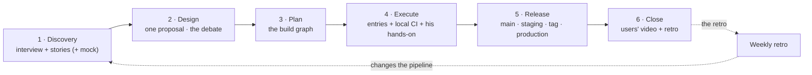

# skills

An opinionated, stage-gated development pipeline for AI agent teams,
built as [Claude Code](https://claude.com/claude-code) skills, agents
and workflows, extracted from production use at a real software
company and published as-is.

**This is not a framework.** It is one team's working pipeline, made
public because the ideas travel even where the specifics don't. Read
it, steal what fits, and shape your own. The best way to use it is to
**fork it and keep editing**: the weekly retro exists to keep
rewriting these files as reality pushes back.

## What it is

A software factory for a team of one: a person says what to build, and
a crew of agents turns it into tested, reviewed, released code, with a
report he can watch at every stage. Several workstreams run at once, through
the night, and he is asked only what is his.

| Rule | What it means |
|---|---|
| **Proof over opinion** | a mock he clicks when a screen changes, ACs that become tests, a gate, QA on the running app; reviewers exist for what cannot be run |
| **Right size** | one proposal sized to the problem, an overengineering guard whose only job is to cut, an evolution path for what was left out; "could be simpler" never blocks |
| **One round** | every review runs once; a fix is verified by reading or by the delta, never by a second round |
| **He is asked only what is his** | the conductor decides his class conservatively and lists it for veto; only a locked AC changed, a new recurring cost or something irreversible becomes a question |
| **A report he can watch** | one link per workstream: each stage gets a Video, a Deck and an Explainer, finished before the stage closes |
| **Local CI** | the whole gate runs on our compute and posts the status `main` requires |
| **It measures itself** | a script reads time, cost and his touches per stage; the weekly retro turns what repeats into changes he rules |

## One door, three routes

```
/lets-cook <idea> ──► scouts in the background ──► a light interview ──► the route, in one line
  ├─ full    ──► the six stages below
  ├─ short   ──► one-page brief ──► /goal ──► one entry ──► his use ──► release ──► short close
  └─ hotfix  ──► brief + a test that reproduces the bug ──► /goal ──► one entry ──► release
```

Every route keeps every check (builder, gate, reviewer and QAs, local
CI, staging, tag, watch); only the ceremony shrinks.

## The six stages



Each stage, except discovery, hands him **one `/goal`**; then it
runs on its own to its close. It closes with its report published and
the next play: `/clear`, then `/stage-<next> <slug>`. The stage
sessions run on Opus 5.5, medium; `/lets-cook` and `/weekly-retro` on
Opus 5.5, high.

| Stage | What happens | His part |
|---|---|---|
| **1 · Discovery** | an interview that infers the obvious from the rest of the system; at its end `story-writer (Sonnet 5.5, high)` writes the stories, one AC per rule; when a screen changes, `prototype-builder (Sonnet 5.5, high)` builds the exact mock in the project's design system and he iterates it until he says it is ready; one review round (`discovery-review-workflow.js`: three `disc-lens (Sonnet 5.5, medium)` and, per story, two `story-reader (Haiku 5.5, high)` and a `blind-judge (Sonnet 5.5, medium)`) | the interview; the mock's rounds; the playback: one plain text, one question |
| **2 · Design** | scouts read the system; `architect (Opus 5.5, high)` drafts one solution with its v1 → v2 → v3 path; `overengineering-guard (Opus 5.5, medium)` cuts; `artifact-builder` draws it as one page; after his "closed", the architect expands `solution.md` and five `design-writer (Sonnet 5.5, high)` write the other documents; four lenses review once, called directly by the session: `design-consistency` and `design-security` (Opus 5.5, medium), `design-contracts (Sonnet 5.5, high)`, the guard again | the debate over one visual page, until "closed" |
| **3 · Plan** | the sprint planning of a team with no size limit: `planner (Opus 5.5, high)` cuts the widest natural graph from today's repo to the design: a thin contract commit C, entries of one whole behaviour (≤12 ACs) with frontend and backend in parallel, E-int last; `plan-writer (Sonnet 5.5, high)` writes one brief per node; one round (`plan-review-workflow.js`: `plan-reviewer (Opus 5.5, medium)` and the double-blind per brief); the session rules everything and writes the pre-flight | nothing; a veto list at the close |
| **4 · Execute** | the session is the tech lead. Every ready entry runs `exec-entry-workflow.js`, in its own cloud session when the project has one: `builder-backend` ∥ `builder-frontend (Opus 5.5, medium)` → `exec-gate (Haiku 5.5, medium)` → `reviewer (Opus 5.5, high)` ∥ `qa-frontend` · `qa-backend (Opus 5.5, medium)` by surface → one fix pass → the delta. A serial queue merges into `feat/<slug>`; the project's signoff command runs the whole gate once, after his ok, and posts `local-ci` | the pre-flight; his hands-on with the running app, each answer an `A.n` round, until "ok" |
| **5 · Release** | merge into `main` behind `local-ci`; the CI deploys staging and smokes; a `vX.Y.Z` tag promotes the same image to production, smokes, watches 15 minutes and rolls back on its own. A red gets one fix entry; a second red stops | his go is the release's `/goal`; a question only on the stop list (a new production deploy after a rollback is one) |
| **6 · Close** | a "what's new" text and, when he asks, a video and a deck that explain the feature to its users and the team, in the project's design system; a short retro with the script's numbers and the proposals for the project's standards; a script proves nothing of the workstream is left on the machine | which material to make |

The **weekly retro** reads every workstream that moved that week,
closed or in flight, with the numbers and signals the stages record on
their own, and proposes changes, each with its evidence and exact edit;
he rules each one (apply · park · drop). It is the only place the
pipeline and a project's standards change.

**The standards book** is each project's own rules in its own repo:
the architecture map, the engineering, testing, security and operations
rules, the design system and the feature maps. `/standards setup`
builds it from the repo and the kit's templates; every stage reads it,
every reviewer cites it by id, and the gaps the work shows come back
through the weekly retro as one pull request (`/standards update`). A
rule the reviewers keep enforcing by hand becomes a check.

## The roster

Every agent is a file under `claude/agents/`. Only **Opus 5.5** and
**Sonnet 5.5** are used: Opus where judgment pays (architecture, the
cut, code, review, QA, the risk lenses), Sonnet for literal reading
and templated writing, never above high.
[docs/models.md](docs/models.md) holds the evidence for each pick.

| Stage | Agent | Model, effort |
|---|---|---|
| all | `scout` | Haiku 5.5, medium |
| every report | `video-builder` | Sonnet 5.5, high |
| every report | `slides-builder` · `artifact-builder` | Sonnet 5.5, medium |
| discovery | `story-reader` | Haiku 5.5, high |
| plan | `blind-reader` | Haiku 5.5, high |
|  | `blind-judge` | Sonnet 5.5, medium |
| discovery | `prototype-builder` | Sonnet 5.5, high |
|  | `story-writer` | Sonnet 5.5, high |
|  | `disc-lens` | Sonnet 5.5, medium |
| design | `architect` | Opus 5.5, high |
|  | `overengineering-guard` | Opus 5.5, medium |
|  | `design-writer` | Sonnet 5.5, high |
|  | `design-consistency` · `design-security` | Opus 5.5, medium |
|  | `design-contracts` | Sonnet 5.5, high |
| plan | `planner` | Opus 5.5, high |
|  | `plan-writer` | Sonnet 5.5, high |
|  | `plan-reviewer` | Opus 5.5, medium |
| execute | `builder-backend` · `builder-frontend` | Opus 5.5, medium |
|  | `exec-gate` | Haiku 5.5, medium |
|  | `reviewer` | Opus 5.5, high |
|  | `qa-frontend` · `qa-backend` | Opus 5.5, medium |
| standards | `standards-writer` | Sonnet 5.5, high |

## The skills

| Skill | Runs as | What it does |
|---|---|---|
| `lets-cook` | session | the one door: interview, route, and the short route and hotfix end to end |
| `stage-discovery` · `stage-design` · `stage-plan` · `stage-execute` · `stage-release` · `stage-close` | session | the six stages |
| `notion-tracker` | session, loaded by the others | optional: pulls a demand from a Notion database and keeps its page in step with the stages |
| `weekly-retro` | session | the week's workstreams read together; the only place the pipeline and a project's standards change |
| `standards` | session | builds a project's standards book from its repo, and applies the changes he approved; publishes the Architecture and Design System pages |
| `draw-it-for-me` | preloaded by `artifact-builder`, `prototype-builder` | explanatory pages: diagrams that build, motion, 3D, charts |
| `pitch-it-for-me` | preloaded by `slides-builder` | HTML slide decks, one idea per slide |
| `make-it-a-movie` | preloaded by `video-builder` | motion films written as one TSX file on the video kit, rendered once |
| `i-wont-read-all-this` | always on | replies shaped for a reader who skims |
| `check` | `/check` | one glanceable line: 🔴 needs you · 🟢 running on its own · ✅ done, then only what the state needs |

Each skill folder has its own `README.md`: what it does, how to install
only it, its files. Knowledge lives in each skill's `references/`.

## The workflows

| Workflow | Stage | Runs | Dry run |
|---|---|---|---|
| `discovery-review-workflow.js` | discovery | three lenses ∥ the double-blind per story | `tests/discovery-review-dry-run.mjs` |
| `plan-review-workflow.js` | plan | the plan reviewer ∥ the double-blind per brief | `tests/plan-review-dry-run.mjs` |
| `exec-entry-workflow.js` | execute, release, lets-cook | one entry: builders → gate → reviewer ∥ QAs → triage → one fix → the delta; modes `build`, `resume`, `update`, `fix` | `tests/exec-entry-dry-run.mjs` |

The design review needs no workflow: the session calls its four lenses
directly.

## The report

Each workstream has **one private link**: a rail of stages, each with
**Video · Deck · Explainer**, filled as each stage closes and finished
before it does. The shell is `claude/report/shell.html` plus a
`report.json`; the video kit (`claude/video/`) renders a TSX film on
its motion library into an MP4; the decks are HTML slides. The short
route's rail is Build · Release · Close. See
[docs/stage-report.md](docs/stage-report.md).

## Local CI

- **The CI is local.** The project's signoff command runs the whole
  gate in a clean worktree on our compute and, only on exit 0 and
  under a bot identity, posts the `local-ci` status `main` requires.
  `claude/scripts/local-ci.sh` is the generic fallback. Hosted CI keeps
  the deploys and the environments.

## The bar

The pipeline is generic: it reads the stack, the commands and the
taste from the project. [docs/project-contract.md](docs/project-contract.md)
is the bar, written as roles in three levels: required (standards,
golden paths, the gates, a stack per worktree, the release roles, the
permissions, the local-CI signoff, the mock toolchain,
the smoke), recommended, and for the full experience (a cloud
environment for entries, the video toolchain).

## Install

Shared across projects by symlink; each project keeps its own settings:

```bash
git clone https://github.com/farias-77/skills.git ~/skills

cd <your-project>/.claude
ln -s ~/skills/claude/skills skills
ln -s ~/skills/claude/agents agents
ln -s ~/skills/claude/workflows workflows
printf '.claude/skills\n.claude/agents\n.claude/workflows\n.claude/settings.local.json\n' >> "$(git rev-parse --git-common-dir)/info/exclude"
npm ci --prefix ~/skills/claude/video   # the reports' renderer and playwright-core for discovery's mock
```

The links stay out of git through `.git/info/exclude`: untracked, they
would trip a secret scan that copies the untracked files (`gitleaks`
behind `cp --parents`) and turn the gate red for no change of yours.

Each stage reads the house rules (`CLAUDE.md` at the clone's root) at
its opening, so the project does not import them. Name the designs
root (where each workstream's folder lives) with the line
`designs-root: ../designs` in the project's `CLAUDE.md`, in git (a
relative path resolves from the main checkout, worktrees included; an
absolute one is accepted too); every stage stops without it.

- **Claude Code** with the `gh` CLI authenticated: GitHub is the
  source of record and the signoff's target.
- The Workflow tool resolves the symlink, and the workstreams' folders sit
  beside the repository: the clone and the designs root go in
  `permissions.additionalDirectories`, in every directory a session
  opens in, or the workflows refuse to start and
  every agent's write there is denied (each stage can still pass a
  workflow inline).
- On the station: Node (current LTS), `ffmpeg` and `npm ci` in
  `claude/video/` for the reports; `playwright-core` and a Chromium for
  discovery's mock (`PLAYWRIGHT_DIR`, `PROTO_CHROME`); `gitleaks` on PATH, or the
  project's `make gitleaks dir=<path>`.
- Headless (`claude -p`, a script, a test harness): pass
  `--settings .claude/settings.json` (print mode ignores the allow
  entries of a workspace never trusted interactively), `--add-dir` for
  the designs root and the clone, and set
  `CLAUDE_CODE_PRINT_BG_WAIT_CEILING_MS=0` (print mode kills background
  agents and workflows 10 minutes after the last turn).
- Project specifics (environments, credentials, deploy targets) live
  in **your** project's `CLAUDE.md` and standards, never in these files.

## Layout

```
CLAUDE.md               the house rules every stage follows
claude/
  GLOSSARY.md           one line per term
  references/           judging.md: the one rule for every review
  skills/               one folder per skill: SKILL.md, README.md, references/, templates/, scripts/
  agents/               every agent, its model and effort in the frontmatter
  workflows/            <name>-workflow.js: the multi-agent rounds, plain JS
  scripts/              local-ci.sh (the fallback signoff), telemetry.mjs, cleanup.sh
  report/               the report shell, the template explainer, a working example
  video/                the video kit (Remotion): the motion library, render.sh
docs/                   the bar, models.md, the stage report, testing the pipeline
tests/                  run.sh: every kit check in one command; the workflows' and local-ci's dry runs
```

Terms are in [claude/GLOSSARY.md](claude/GLOSSARY.md).

## License

[MIT](LICENSE). Take what serves you.
