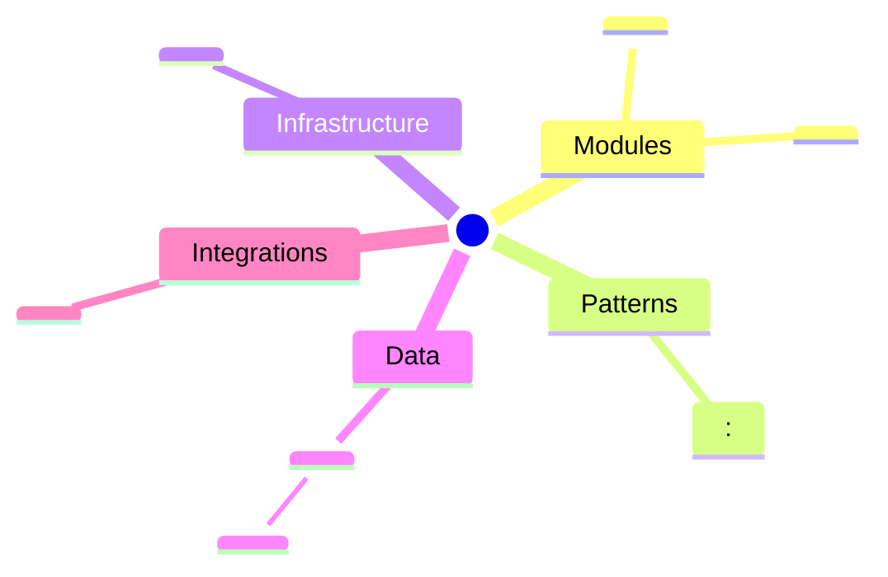

# Architecture · <project>

<!-- Read by design, plan and execute, and drawn as the `Architecture -
<project>` page. Seeded by the kit's `standards` skill; the project owns
it and changes it only by pull request. Rule ids are never changed and
never reused. -->

The living map of the system: what it is made of, where each kind of
code starts, and how it may grow. An agent reads this file instead of
rediscovering the codebase, so every row must match the code on `main`.

## The system in one picture

The `Architecture - <project>` page draws this mind map. Each leaf is a
row of a table below; a golden-path leaf links to its file.

## Context

Who uses the system and what it talks to.

| Actor or system | Kind | What it does with us | Through |
|---|---|---|---|
| `<role>` | person | `<the main job it comes to do>` | `<web app, API, e-mail>` |
| `<external service>` | system | `<what we call it for, or what it sends us>` | `<HTTPS, webhook, queue>` |

## Modules and layers

| Module | Path | Owns | Depends on |
|---|---|---|---|
| `<module>` | `<path>` | `<its facts: tables, route prefix, events>` | `<modules it imports>` |

Each module is layered, outside in: the entry (HTTP handler, consumer,
job, screen) → the use case → the domain. Infrastructure adapters (the
database, the external clients) sit behind interfaces the use case
declares.

- **ARC-1** · Imports point inward only: an entry imports use cases, a use case imports the domain and its own interfaces, and the domain imports no other layer. *Why:* the core stays testable without the outside world.
- **ARC-2** · Another module is imported only through its public entry `<module>/<public file>`; its internals are never imported from outside. *Why:* a module can change inside without breaking its neighbours.
- **ARC-3** · The import fences of ARC-1 and ARC-2 are enforced by `<structure check command>`, and a diff never adds an exception to them. *Why:* a fence a reviewer checks by hand erodes.
- **ARC-4** · Module dependencies form no cycle. *Why:* a cycle makes two modules one module with two names.
- **ARC-5** · A capability that already has a mechanism (an HTTP client, a job runner, a logger, a config loader, a date library) gets no second one; the existing one is extended. *Why:* the next contributor copies the nearest example, and two examples give two shapes.
- **ARC-6** · Each fact (a table, an enum, a configuration value, a list of allowed values) has one owning module, named in the table above; other modules read it from the owner and never keep a copy. *Why:* a fact kept in two places drifts, and a list synced by hand is always one entry short.

## Golden paths

One exemplar per kind of code. A new file of that kind starts as a
copy of its exemplar.

| Kind of code | Golden path | What to copy |
|---|---|---|
| server module | `<path>` | the folder layout, the public entry, the wiring in `<composition root>` |
| endpoint | `<path>` | input decoding, the call to one use case, the error mapping, the contract entry |
| use case | `<path>` | the authorization check, the transaction boundary, the effects after the commit |
| job or consumer | `<path>` | idempotency by event id, the bounded run, the failure state and its log line |
| migration | `<path>` | the file name by timestamp, the timeouts, an expand-only change |
| screen | `<path>` | the route, the data loading, the loading, empty and error states |
| component | `<path>` | the props, the tokens it uses, its story or preview |
| form | `<path>` | validation, the submit state, the server error shown in place |
| e-mail | `<path>` | the template, the plain-text part, the send through `<mail client path>` |
| unit test | `<path>` | the arrange-act-assert shape, the fixtures |
| integration test | `<path>` | the real database, the test actor, the cleanup |
| browser test | `<path>` | the login as a test actor, the locators, the assertions on visible text |
| journey | `<path>` | the steps per state, the read-only marker when it writes nothing |

A kind the codebase lacks says `none: the next plan's contract commit builds the first`.

- **ARC-7** · A new file of a kind in the table follows its golden path; a different shape is a pull request that changes the golden path, never a one-off. *Why:* parallel builders converge on one shape only when one shape is named.
- **ARC-8** · Every golden path names a file that exists on `main` and is covered by its tests. *Why:* an exemplar that is gone or broken teaches the wrong thing.
- **ARC-9** · The contract commit that builds the first file of a missing kind also fills that kind's row here. *Why:* the second builder must find the first exemplar.

## Infrastructure

Generated from the IaC by `<command>`; never edited by hand.

| Resource | Kind | Env | Declared in | Owner |
|---|---|---|---|---|
| `<resource>` | `<service, database, bucket, queue, job, secret>` | `<staging, production>` | `<path>` | `<module>` |

- **ARC-10** · Every cloud resource, identity, role binding and secret name is declared in the IaC under `<path>`; `<IaC plan command>` on `main` shows no change. *Why:* a resource made in a console is invisible to review and lost on rebuild.
- **ARC-11** · A diff that changes the IaC regenerates the table above with `<command>` in the same diff. *Why:* the map is only trusted when it cannot drift from its source.
- **ARC-12** · Each service runs as its own identity with only the roles its table row needs; no identity is shared between services and none holds an owner or editor role. *Why:* a leaked or buggy service can only touch what it owns.
- **ARC-13** · Staging and production are built from the same IaC modules and differ only in variable values (sizes, counts, domains, secret names). *Why:* a green staging proves production only when they are alike.

## Data

| Store | Kind | Tables or prefixes | Owner module | Retention |
|---|---|---|---|---|
| `<store>` | `<relational, object, cache>` | `<table>` | `<module>` | `<how long, and what deletes it>` |

- **ARC-14** · Only a table's owner module writes to it; another module reads it through the owner's public entry. *Why:* one writer keeps the invariants in one place.
- **ARC-15** · Every store has a retention line, and data past it is removed by a named job or a store lifecycle rule. *Why:* data kept with no end is a cost and a liability nobody decided.

## Integrations

| Service | What for | Client path | Timeout | When it fails |
|---|---|---|---|---|
| `<external service>` | `<the job it does for us>` | `<path>` | `<n> s` | `<what the user sees, what is logged, what retries>` |

- **ARC-16** · Each external service has exactly one client, at the path in the table; no other code calls the service. *Why:* the timeout, the retries and the logging live in one place.
- **ARC-17** · Every row states its timeout and its failure behaviour, and the client code matches them. *Why:* the failure path is designed once, not discovered in production.

## How it grows

The system grows from what already runs. A design starts from the
modules, primitives and resources above, and writes what a bigger
version would add as an evolution path with the signal that triggers
it, never as code now.

- **ARC-18** · A new service, store, queue, vendor or library enters only with a line in the design's `solution.md` naming the existing primitive that could carry the need and why it does not. *Why:* each new component is a cost paid on every later change.
- **ARC-19** · A limit that configuration carries (a size, a count, a concurrency, a pool) is raised by configuration; a redesign for scale cites a measured signal with its number. *Why:* a redesign for a limit months away is paid now for a need that may never come.
- **ARC-20** · A configuration knob is added only when two environments or two audiences set it differently, and a helper only when it has two call sites; otherwise the value or the code stays inline. *Why:* an abstraction with one user is indirection the next reader must undo.

## Keeping it current

- **ARC-21** · The diff that adds or removes a module, a route prefix, a store or table, a resource, an integration or a kind of code updates this file in the same diff. *Why:* the next agent reads this file, not the history.
- **ARC-22** · The workstream's close checks for drift (a scout over the release's diff, or `<drift check command>` when the project has one): every module folder, route prefix, IaC resource and external host the code has and the tables above miss; each one found becomes a `[standards]` line. *Why:* drift caught at each close stays one row, not a rewrite.
